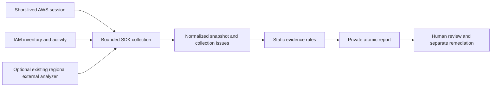

# Threat model and security decisions

Trust boundaries are local configuration, the AWS credential chain, AWS responses, policy-controlled strings, and exported reports. The operator authorizes the accounts explicitly. A compromised policy author can create misleading grants, conditions or names; AWS evidence is a point-in-time observation rather than an atomic transaction. The project does not protect against a compromised local runtime or operator session.

No IAM write calls occur in collection. STS assumptions use temporary credentials, an explicit role and optional ExternalId, bounded session duration, and no credential persistence. Reports include account metadata; files are written atomically with mode 0600. Keep directories and CI artifacts private when handling real accounts. Key material is never collected; key IDs become suffixes and SHA-256 fingerprints.

SDK timeouts, retries, polling and pagination limits constrain individual operations. A maximum of 100 accounts is accepted by the CLI. Limits can make large-account results incomplete; issues remain visible and exit code 2 overrides finding thresholds. This is not a global wall-clock or memory budget. Sequential collection may still be lengthy. Configuration is capped at 64 KiB and YAML aliases/anchors are rejected.

Observed missing MFA assignment is classified as an observed misconfiguration. Other findings are review candidates. No result is classified as validated effective permission. Conditions, denies, boundaries, SCPs, resource policies and session policies can change authorization. Boundary ARNs are collected as context, never interpreted as sufficient protection. AWS-managed and local policy documents are inspected; group inline and managed grants are included. Static findings on unattached policies remain hygiene candidates.

OIDC checks conservatively review missing exact issuer-qualified audience/subject conditions. StringLike patterns, provider claim semantics, SAML assertions, IdP configuration and session claims need specialist review. Passing these checks does not prove safe federation. ExternalId checks do not model every trust condition or deny. Access Analyzer complements static checks using AWS external-access evidence; it does not prove a principal successfully used access. Analyzer trust zones, archival rules, freshness and region coverage remain the operator's responsibility.

Access Advisor reports attempts, including denied attempts, within service retention limits. Missing activity is not proof of unused authorization. MFA assignment is not enforcement. A complete report means requested collection succeeded, not that all AWS security surfaces were audited. Root, Identity Center, resource-policy inventory, combined escalation paths and effective permission calculation remain outside scope.
